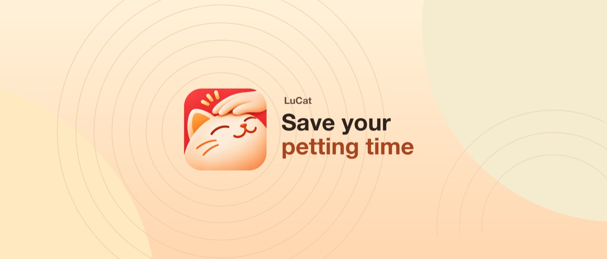

# 🐾 LuCat · Apple Watchで猫との時間を記録

[English](README.en.md) | [简体中文](README.zh-Hans.md) | [繁體中文（香港）](README.zh-Hant-HK.md) | [Русский](README.ru.md) | [Português (Brasil)](README.pt-BR.md) | [Español (México)](README.es-MX.md) | [Français](README.fr.md) | [Deutsch](README.de.md) | [Italiano](README.it.md) | [日本語](README.ja.md)

**[App Storeで無料ダウンロード](https://apps.apple.com/us/app/lucat-cat-petting-timer/id6835910184)** · [GitHubの紹介](https://betaer.github.io/lucat/ja/) · [Xの元の投稿を読む](https://x.com/Betaer/status/2124558620260188334)

## 猫をなでるためのアプリ？

Apple Watchで運動を記録できるなら、モーションセンサーで猫をなでる時間も記録できるのでは？そんな思いつきからLuCatを作りました。

散歩と同じように、猫と過ごす数分間も記録に残したい。LuCatは猫ごとのふれあいの時間をApple WatchからiPhoneへ届けます。

## 使い方

Apple Watchで猫を選び、開始をタップして、ふれあいを楽しんでください。終了すると自動保存され、ペアリングしたiPhoneに同期されます。カレンダーで、いつ、どの猫と、どれくらい過ごしたか、記録された動きとともに振り返れます。

## 猫ごとのプロフィール

猫を追加して写真を撮影し、タップして大きく表示できます。複数の猫がいても、それぞれの履歴を別々に管理できます。わが家の4匹にも、それぞれの記録があります。

## 体重の記録

成長中の子猫にも、体重管理中の猫にも。測定するたびに記録して、猫ごとの体重の変化をグラフで確認できます。

## リマインダーと小さな目標

毎日3分、または3回といった目標を設定できます。忙しい日にも猫との時間を忘れずに。通知には猫の写真が順番に表示されます。

## 動きの振り返り

手首の動きから推定した動作のタイムラインやふれあいの強さを確認できます。猫に加わる力や圧力を直接測定するものではありません。

## 開発の話

ChatGPT Dotとの自然言語での対話で開発し、ときどき画像も共有しました。Google Gemini Carbonで2回コードレビューを行いました。期間は約1週間、1日8時間換算で約3日分の作業でした。

## これから

ワクチン接種記録とメモ、動作認識の改善、時計のデータからなでる様子を再現する実験を予定しています。映像の再現はまだ模索中です。ご意見をお待ちしています。

## コミュニティ

新機能のアイデアやご感想をぜひお寄せください。わが家の4匹を代表して、応援してくださる皆さんに感謝します！

[Xチャットに参加](https://x.com/i/chat/group_join/g2122385444969349533/55EEg15kcr) · [WeChatと小紅書](https://docs.qq.com/doc/DVmpqSXpBYmVsdnZK)

[プライバシー](https://betaer.github.io/lucat/privacy/?lang=ja)
